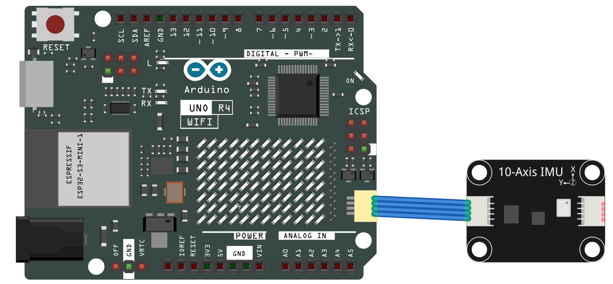

.. note::

    こんにちは、SunFounderのRaspberry Pi & Arduino & ESP32愛好家コミュニティへようこそ！Facebook上でRaspberry Pi、Arduino、ESP32についてもっと深く掘り下げ、他の愛好家と交流しましょう。

    **参加する理由は？**

    - **エキスパートサポート**：コミュニティやチームの助けを借りて、販売後の問題や技術的な課題を解決します。
    - **学び＆共有**：ヒントやチュートリアルを交換してスキルを向上させましょう。
    - **独占的なプレビュー**：新製品の発表や先行プレビューに早期アクセスしましょう。
    - **特別割引**：最新製品の独占割引をお楽しみください。
    - **祭りのプロモーションとギフト**：ギフトや祝日のプロモーションに参加しましょう。

    👉 私たちと一緒に探索し、創造する準備はできていますか？[|link_sf_facebook|]をクリックして今すぐ参加しましょう！

.. _basic_imu:

IMUモジュール（10軸）
==========================

.. note:: このキットの異なるバージョンでは、異なるIMUモジュールが使用されている場合があります。お持ちのキットのバージョンに基づいて、適切なチュートリアルを選択してください。10軸IMUモジュールをお持ちの場合は、このチュートリアルを参照してください。GY-87モジュールをお持ちの場合は、:ref:`basic_gy87`\ を参照してください。

10軸IMU（慣性計測ユニット）モジュールは、複数のセンサーを組み合わせて、包括的な動作および環境データを提供します。高度測定用の気圧センサー（SPL06_001）、加速度および回転用の6軸モーションセンサー（SH3001）、コンパス方位用の3軸磁力計（QMC6310）を統合しています。この高度なモジュールは、ロボティクス、ナビゲーションシステム、モーショントラッキングアプリケーションに最適です。

Fritzing回路
----------------------------------

.. raw:: html

    

.. .. image:: img/09_basic_gy87_schematic.png
..     :align: center
..     :width: 90%

キャリブレーション
----------------------

センサーデータを読む前に IMU をキャリブレーションして、測定値を正確にします。

#. **SunFounder_IMU** ライブラリをインストールします：Arduinoライブラリマネージャーを開き、**"SunFounder_IMU"** を検索して **INSTALL** をクリックします。下の画像はインストール後の表示です。

   .. image:: img/09-add_lib_tip_imu.png
      :align: center

#. ``elite-explorer-kit-main\basic_project\09-imu_calibration`` のパスにある ``09-imu_calibration.ino`` を開き、ボードにアップロードします。

#. シリアルモニタを開き、ボーレートを **115200**、行末文字を **Both NL & CR** に設定します。

#. シリアルモニタの指示に従って、6 面のキャリブレーションを行います：

   * 任意の文字を送信して開始します。シリアルモニタに最初の向きが表示されます。
   * 指示された順に、モジュールを 6 つの向きに置きます：Z 面を上、Z 面を下、X 面を上、X 面を下、Y 面を上、Y 面を下。
   * 各測定中はモジュールを完全に静止させ、そのあとで再度任意の文字を送信して現在の向きを測定し、次の向きに進みます。

   .. image:: img/09_imu_cali.png
      :align: center
      :width: 90%

#. 6 つ目の向きが終わると、シリアルモニタにキャリブレーション定数が出力されます。次の 6 行をコピーします：

   .. code-block:: text

      Calibration complete!
      Copy the following calibration data to your calibration_data.h:
      const float ACCEL_BIAS[3] = {-0.0345, 0.0192, -0.1268};
      const float ACCEL_SCALE[3] = {1.0012, 0.9987, 1.0005};
      const float GYRO_BIAS[3] = {0.4120, -0.2085, 0.0331};
      const float GYRO_SCALE[3] = {1.0000, 1.0000, 1.0000};
      const float MAG_BIAS[3] = {-212.5000, 87.2500, -341.0000};
      const float MAG_SCALE[3] = {0.9620, 1.0110, 1.0270};

   上の値はあくまで例です。実際の値はお使いのモジュール固有のものです。

#. ``09-imu`` プロジェクトとその ``calibration_data.h`` タブを開き、6 つの配列をコピーした値に置き換えます。

   .. image:: img/imu_cali_data.png
      :align: center
      :width: 80%

#. ``09-imu.ino`` を Arduino Uno R4 ボードにアップロードします。シリアルモニタに加速度計・ジャイロスコープ・磁力計・気圧計のデータが連続して出力されます。

   .. image:: img/imu_reading.png
